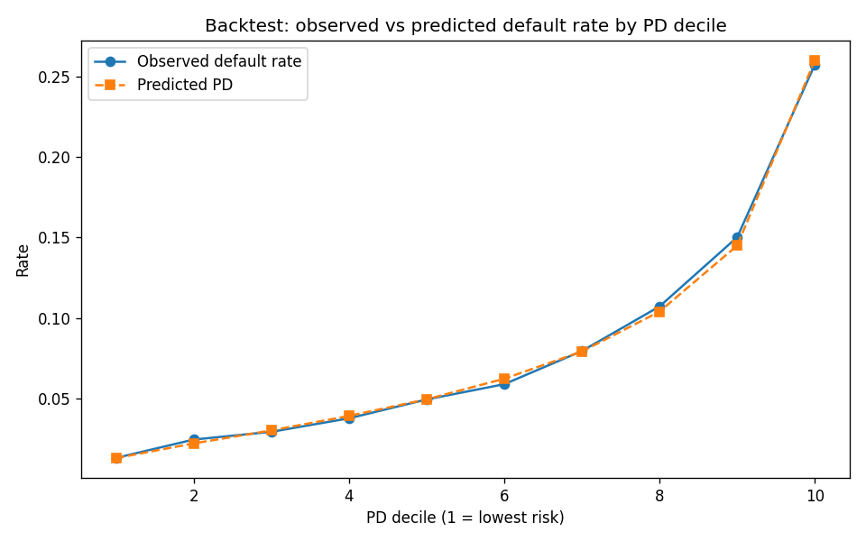
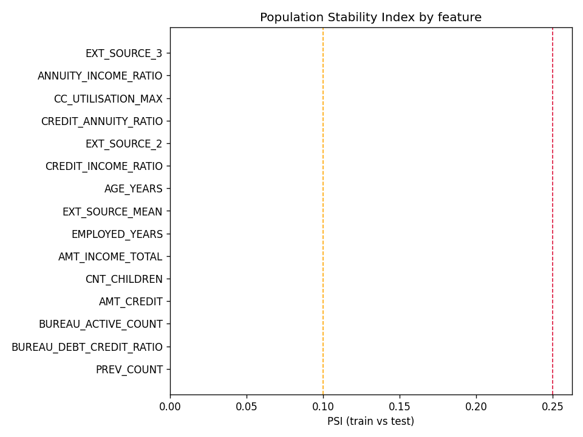
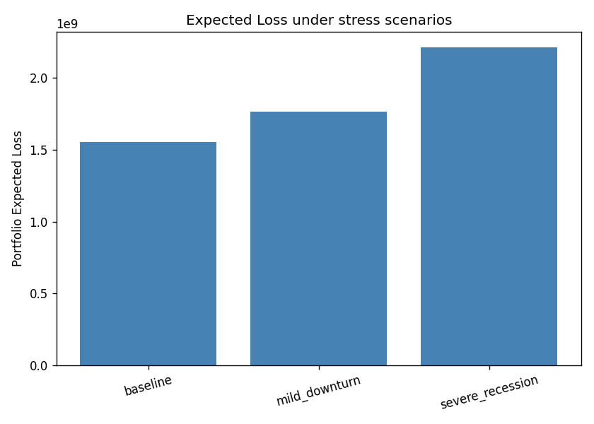

# Independent Model Validation Report

**Model under review:** Home Credit Default Risk WoE scorecard (champion) and LightGBM challenger, from the `credit-risk-scorecard` repository.

**Validation scope:** data quality, conceptual soundness, discrimination and calibration backtesting, overfitting, population stability (PSI), multicollinearity (VIF), sensitivity analysis, and stress testing. All checks were performed by independently reproducing the model from the development team's codebase on the same train/test split, then assessing it from first principles rather than reusing the development team's own reported metrics.

---

## 1. Executive Summary

Sample: 230,633 training / 76,878 test applicants.

**Overall assessment: Conceptually reasonable but with multiple findings that warrant follow-up before the model is relied upon without additional controls.**

**Key findings:**

- 8 feature(s) show high multicollinearity (VIF > 10). See Section 5.
- 1 feature(s) have a suspiciously high Information Value (> 0.5): EXT_SOURCE_MEAN. This can indicate target leakage and should be investigated before the model is relied upon. See Section 3.
- 3 feature(s) are missing in over 30% of records, which the champion model's binning silently absorbs into a 'missing' bin. Business sign-off is needed on whether that is an acceptable risk treatment. See Section 2.
- The LightGBM challenger shows a 0.077 Gini gap between train (0.6095) and test (0.5325), consistent with some overfitting. It is used only as a benchmark, not for decisioning, which limits the materiality of this finding. See Section 6.

---

## 2. Data Quality Assessment

Missingness, type consistency, and robust outlier rate (values beyond 5 median-absolute-deviations) for every model input:

| feature                  | dtype   |   missing_pct |   outlier_pct_robust_z5 |   n_unique |
|:-------------------------|:--------|--------------:|------------------------:|-----------:|
| CC_UTILISATION_MAX       | float64 |        0.7202 |                  0.0001 |      56150 |
| CC_UTILISATION_MEAN      | float64 |        0.7202 |                  0      |      59105 |
| CC_DPD_MAX               | float64 |        0.7174 |                nan      |        409 |
| EXT_SOURCE_3             | float64 |        0.1983 |                  0      |        814 |
| EMPLOYED_YEARS           | float64 |        0.1801 |                  0.018  |        464 |
| BUREAU_DEBT_CREDIT_RATIO | float64 |        0.1467 |                  0.0004 |     184778 |
| BUREAU_OVERDUE_MAX       | float64 |        0.1431 |                nan      |        868 |
| BUREAU_ACTIVE_COUNT      | float64 |        0.1431 |                  0.0028 |         23 |
| BUREAU_COUNT             | float64 |        0.1431 |                  0.0136 |         60 |
| PREV_REFUSED_RATIO       | float64 |        0.0535 |                nan      |        397 |
| PREV_COUNT               | float64 |        0.0535 |                  0.0124 |         65 |
| INST_PAYMENT_RATIO_MEAN  | float64 |        0.0516 |                nan      |      42704 |
| INST_DAYS_LATE_MEAN      | float64 |        0.0516 |                  0.0178 |      62113 |
| INST_DAYS_LATE_MAX       | float64 |        0.0516 |                  0.0396 |       1684 |
| EXT_SOURCE_2             | float64 |        0.0021 |                  0      |     119831 |
| EXT_SOURCE_MEAN          | float64 |        0.0007 |                  0      |     290970 |
| CREDIT_INCOME_RATIO      | float64 |        0      |                  0.0065 |      48697 |
| ANNUITY_INCOME_RATIO     | float64 |        0      |                  0.004  |      88811 |
| AMT_CREDIT               | float64 |        0      |                  0.0016 |       5603 |
| AMT_INCOME_TOTAL         | float64 |        0      |                  0.0101 |       2548 |
| AGE_YEARS                | float64 |        0      |                  0      |        483 |
| CREDIT_ANNUITY_RATIO     | float64 |        0      |                  0      |      39539 |
| NAME_EDUCATION_TYPE      | object  |        0      |                nan      |          5 |
| NAME_FAMILY_STATUS       | object  |        0      |                nan      |          6 |
| CODE_GENDER              | object  |        0      |                nan      |          3 |
| CNT_CHILDREN             | int64   |        0      |                nan      |         15 |

---

## 3. Conceptual Soundness

Information Value (IV) ranks each feature's standalone predictive strength. IV in the 'strong' or 'medium' range is expected for a well-built scorecard; IV above 0.5 ('suspicious') more often signals target leakage than genuine signal and should be investigated.

Suspicious-IV features: EXT_SOURCE_MEAN.

**Discrimination and calibration backtest** (held-out test set, PD deciles, 1 = lowest predicted risk):

| band              |    n |   observed |   mean_pd |   expected |   observed_rate |   band_rank |
|:------------------|-----:|-----------:|----------:|-----------:|----------------:|------------:|
| (0.00169, 0.0181] | 7688 |        101 |    0.013  |    99.9578 |          0.0131 |           1 |
| (0.0181, 0.0261]  | 7688 |        188 |    0.0221 |   170.09   |          0.0245 |           2 |
| (0.0261, 0.0346]  | 7688 |        225 |    0.0302 |   232.539  |          0.0293 |           3 |
| (0.0346, 0.0441]  | 7687 |        290 |    0.0392 |   301.208  |          0.0377 |           4 |
| (0.0441, 0.0553]  | 7688 |        380 |    0.0495 |   380.866  |          0.0494 |           5 |
| (0.0553, 0.0697]  | 7688 |        453 |    0.0623 |   478.949  |          0.0589 |           6 |
| (0.0697, 0.0898]  | 7687 |        611 |    0.0792 |   608.655  |          0.0795 |           7 |
| (0.0898, 0.12]    | 7688 |        824 |    0.104  |   799.201  |          0.1072 |           8 |
| (0.12, 0.178]     | 7688 |       1155 |    0.145  |  1114.69   |          0.1502 |           9 |
| (0.178, 0.671]    | 7688 |       1979 |    0.2601 |  1999.59   |          0.2574 |          10 |

Hosmer-Lemeshow goodness-of-fit: chi2 = 6.99, dof = 8, p-value = 0.5381 (calibration not rejected at the 5% level).

---

## 4. Population Stability (PSI, train vs test)

PSI < 0.10 stable, 0.10-0.25 moderate shift (monitor), > 0.25 significant shift (recalibration may be needed). This dataset has no application-date field, so train-vs-test stands in for a genuine out-of-time comparison.

| feature                  |    psi | flag   |
|:-------------------------|-------:|:-------|
| EXT_SOURCE_3             | 0.0005 | stable |
| ANNUITY_INCOME_RATIO     | 0.0003 | stable |
| CC_UTILISATION_MAX       | 0.0003 | stable |
| CREDIT_ANNUITY_RATIO     | 0.0002 | stable |
| EXT_SOURCE_2             | 0.0002 | stable |
| CREDIT_INCOME_RATIO      | 0.0001 | stable |
| AGE_YEARS                | 0.0001 | stable |
| EXT_SOURCE_MEAN          | 0.0001 | stable |
| EMPLOYED_YEARS           | 0.0001 | stable |
| AMT_INCOME_TOTAL         | 0.0001 | stable |
| CNT_CHILDREN             | 0.0001 | stable |
| AMT_CREDIT               | 0.0001 | stable |
| BUREAU_ACTIVE_COUNT      | 0.0001 | stable |
| BUREAU_DEBT_CREDIT_RATIO | 0.0001 | stable |
| PREV_COUNT               | 0.0001 | stable |

---

## 5. Multicollinearity (VIF)

VIF > 5 moderate concern, > 10 severe. The WoE binning step tempers the practical impact of collinearity on the fitted scorecard, but raw-feature VIF is still reported here as the independent-input-space view a validator needs, separate from how the champion model internally transforms them.

| feature                  |    vif | flag     |
|:-------------------------|-------:|:---------|
| EXT_SOURCE_MEAN          | 177.33 | high     |
| EXT_SOURCE_2             |  75.62 | high     |
| EXT_SOURCE_3             |  52.25 | high     |
| CREDIT_ANNUITY_RATIO     |  30.61 | high     |
| CREDIT_INCOME_RATIO      |  28.75 | high     |
| ANNUITY_INCOME_RATIO     |  25.1  | high     |
| AGE_YEARS                |  16.63 | high     |
| CC_UTILISATION_MAX       |  14.81 | high     |
| AMT_CREDIT               |   7.59 | moderate |
| CC_UTILISATION_MEAN      |   5.7  | moderate |
| BUREAU_ACTIVE_COUNT      |   5.63 | moderate |
| BUREAU_COUNT             |   5.55 | moderate |
| PREV_COUNT               |   3.13 | low      |
| INST_DAYS_LATE_MEAN      |   2.49 | low      |
| EMPLOYED_YEARS           |   2.26 | low      |
| PREV_REFUSED_RATIO       |   1.65 | low      |
| AMT_INCOME_TOTAL         |   1.52 | low      |
| CNT_CHILDREN             |   1.46 | low      |
| BUREAU_DEBT_CREDIT_RATIO |   1.45 | low      |
| INST_DAYS_LATE_MAX       |   1.4  | low      |
| CC_DPD_MAX               |   1.06 | low      |
| BUREAU_OVERDUE_MAX       |   1    | low      |
| INST_PAYMENT_RATIO_MEAN  |   1    | low      |

---

## 6. Overfitting Check (train vs test performance)

| model               |   train_auc |   test_auc |   auc_gap |   train_gini |   test_gini |   gini_gap |
|:--------------------|------------:|-----------:|----------:|-------------:|------------:|-----------:|
| WoE scorecard       |      0.7487 |     0.748  |    0.0007 |       0.4974 |      0.496  |     0.0014 |
| LightGBM challenger |      0.8048 |     0.7663 |    0.0385 |       0.6095 |      0.5325 |     0.077  |

---

## 7. Sensitivity Analysis

Score shift (in scorecard points) from perturbing one input at a time on a 20,000-applicant sample, holding all other inputs fixed. A high `sensitivity_ratio` (mean absolute shift relative to the natural spread of scores) flags a feature the model may be disproportionately reactive to.

| feature             | perturbation     |   mean_score_shift |   mean_abs_score_shift |   sensitivity_ratio |
|:--------------------|:-----------------|-------------------:|-----------------------:|--------------------:|
| EXT_SOURCE_2        | -0.10 (absolute) |              -5.04 |                   5.04 |              0.185  |
| EXT_SOURCE_2        | -0.05 (absolute) |              -2.77 |                   2.77 |              0.1016 |
| EXT_SOURCE_2        | +0.05 (absolute) |               2.8  |                   2.8  |              0.1027 |
| EXT_SOURCE_2        | +0.10 (absolute) |               5.41 |                   5.41 |              0.1986 |
| EXT_SOURCE_3        | -0.10 (absolute) |              -3.52 |                   3.52 |              0.1293 |
| EXT_SOURCE_3        | -0.05 (absolute) |              -1.75 |                   1.75 |              0.0643 |
| EXT_SOURCE_3        | +0.05 (absolute) |               1.61 |                   1.61 |              0.0592 |
| EXT_SOURCE_3        | +0.10 (absolute) |               3.11 |                   3.11 |              0.1143 |
| AMT_INCOME_TOTAL    | -20%             |              -0.14 |                   0.34 |              0.0126 |
| AMT_INCOME_TOTAL    | -10%             |              -0.09 |                   0.2  |              0.0074 |
| AMT_INCOME_TOTAL    | +10%             |               0.1  |                   0.13 |              0.0048 |
| AMT_INCOME_TOTAL    | +20%             |               0.3  |                   0.35 |              0.013  |
| CREDIT_INCOME_RATIO | -20%             |              -0    |                   0.09 |              0.0031 |
| CREDIT_INCOME_RATIO | -10%             |               0    |                   0.05 |              0.0017 |
| CREDIT_INCOME_RATIO | +10%             |              -0    |                   0.05 |              0.0017 |
| CREDIT_INCOME_RATIO | +20%             |              -0.01 |                   0.07 |              0.0026 |
| AGE_YEARS           | -5 years         |              -0.85 |                   0.85 |              0.0313 |
| AGE_YEARS           | -2 years         |              -0.36 |                   0.36 |              0.0132 |
| AGE_YEARS           | +2 years         |               0.36 |                   0.36 |              0.0133 |
| AGE_YEARS           | +5 years         |               0.9  |                   0.9  |              0.0331 |

---

## 8. Stress Testing

Portfolio-level Expected Loss (PD x LGD x EAD, LGD = 0.45) under two combined adverse scenarios applied to the full test portfolio simultaneously, modelled on the kind of income/collateral shock a Pillar 2 stress test would apply:

| scenario         |   mean_pd |   portfolio_expected_loss |   el_change_pct |
|:-----------------|----------:|--------------------------:|----------------:|
| baseline         |    0.0805 |               1.55152e+09 |            0    |
| mild_downturn    |    0.091  |               1.76671e+09 |           13.87 |
| severe_recession |    0.1128 |               2.21081e+09 |           42.49 |

---

## 9. Limitations of This Validation

- Train/test split is a random hold-out, not a true out-of-time sample; PSI and backtesting results should be revisited once vintage/time data is available.
- Stress scenarios are illustrative shock magnitudes, not calibrated to a specific regulator-mandated macroeconomic scenario.
- LGD is a fixed 0.45 Basel proxy and EAD uses credit amount as a proxy, both simplifying assumptions inherited from the model under review, not independently re-derived here.

---

## 10. Recommendations for Model Governance

1. Track this report's findings (Section 1) in the model's limitations log and revisit at the next scheduled review.
2. Investigate any suspicious-IV features for leakage before relying on the model for a go-live decision.
3. Re-run PSI once genuine out-of-time data is available; a random train/test split understates how much real-world drift could occur.
4. Extend stress testing to a wider range of severities and, where possible, align scenario design with the Bank's official stress-testing methodology rather than illustrative shocks.
